# Spanning-Tree Protocol

Keeping the same energy here, with the same source materials (the CCNA and [Johannes Weber's Ultimate PCAP](https://weberblog.net/the-ultimate-pcap/)), I was curious to see STP traffic. To my surprise, if done methodically and with patience, an STP topology can be infered just by analyzing STP packets.

## Introduction

- _File_: STP_UltimatePCAP.pcapng
- _Context_: Studying for the CCNA's STP module.

## Findings

- For the purposes of this analysis, the scope will be Per-VLAN Spanning Tree traffic. For starters, the _Conversations_ section was investigated and only two streams were chosen: 0 and 1.

### Stream 0

- _Source MAC_: _00:0a:8a:a1:5a:9a_ (Port 5a9a, from now on).

- _Destination MAC_: _01:00:0c:cc:cc:cd_ (PVST+), meaning, the Port 5a9a is sending a BPDU to everyone listening at this destination MAC (multicast).

- There are two Root Bridges identified: _00:0a:8a:a1:5a:80_ (Root Bridge 5a80) and _00:21:1b:ae:31:80_ (Root Bridge 3180).

#### Root Bridge 5a80

- Focusing on _Root Bridge 5a80_, it is seen that the Root Bridge and Bridge IDs are equal, the latter of which corresponds to the switch that originated Stream ID 0. After doing some research, it was found that these IDs' MAC addresses correspond to the chassis MAC addresses.

- If both the Root and Bridge IDs are equal, this means that the source device is considering **itself** as the Root Bridge!

	

- This also means Port 5a9a should be a _Designated_ port.

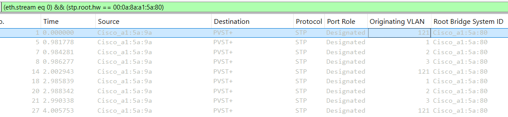

- Finally, since it is PVST+, the VLANs, this switch is a Root Bridge of, are the 1, 2, 3, and 121. 

#### Root Bridge 3180

- Focusing on _Root Bridge 3180_, it is seen that Port 5a9a is a _Root Port_ of it.

	

- The Root Bridge and Bridge IDs are different, meaning Root Bridge 3180 is the root bridge for VLANs 10, 20, 30, 40, 50, 60, 70, 80, and 90.

	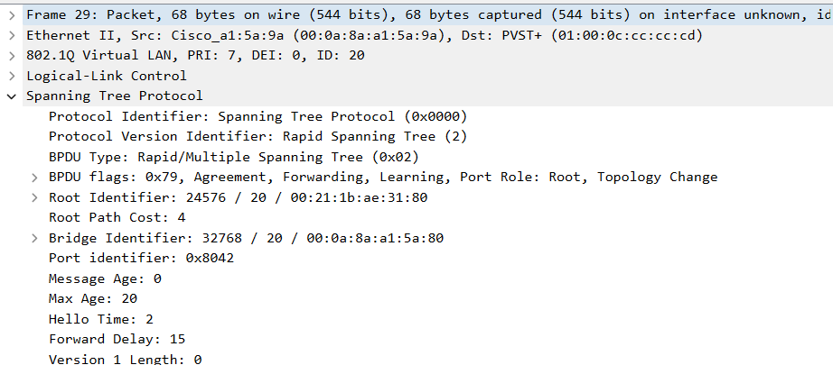

### Stream 1

- _Source MAC_: _00:21:1b:ae:31:99_ (Port 3199).

- _Destination MAC_: _01:00:0c:cc:cc:cd_ (PVST+), meaning, the Port 3199 is sending a BPDU to everyone listening at this destination MAC (multicast).

- Easily enough for this stream, the Root Bridge and Bridge IDs are equal.

	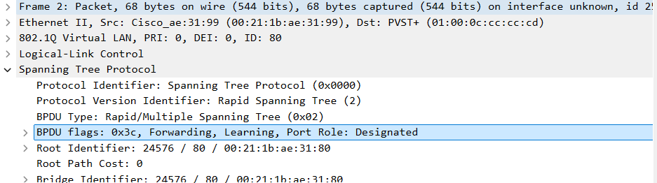

- Port 3199 is seen as _Designated_ for VLANs 10, 20, 30, 40, 50, 60, 70, 80, and 90. Port 3199 is not tagged as being the Root Port of any other STP topology.

### Curiosities

- A Bridge Identifier is made up of the _Bridge Priority_, _Bridge System ID Extension_ (which is equal to the associated VLAN), and _Bridge System ID_ (which is the chassis MAC address).

	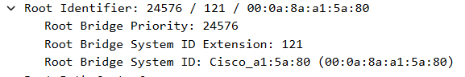

- _Root Path Cost_: The interface's cost toward the Root Bridge. For Designated ports in a Root Bridge, the value should be 0. For any other port of any other non-Root Bridges, this cost changes. Below is an example of a _Root Path Cost_ equal to 4, which according to the _Short Path Cost Method_, it should correspond to a 1GB interface!

	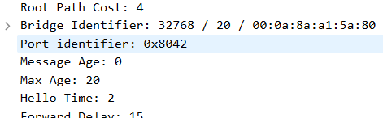

__________________________________________________________________________

# SLAAC Sighting

Since I am still fond of finding IPv6 addresses, I figure I might as well continue analyzing them a bit longer. 

After learning more about how devices get assigned an IPv6 address, I sought out to find a SLAAC process. This was not easy since Wireshark has no way of identifying a EUI-64 address. Also, Wireshark does not support using using specific byte information in search filter variables. I mean, I was trying to use something like `ipv6.addr[14:2] eq ${eth.addr[4:2]}`, in order to find bytes in the IPv6 address similar to bytes in the MAC address, but this was not possible.

This means, I had to understand the SLAAC process and search by eye!

Again, this analysis is done with the help of  [Johannes Weber's Ultimate PCAP](https://weberblog.net/the-ultimate-pcap/).

## Introduction

- _File_: IPV6_Captures_UltimatePCAP.pcapng
- _Context_: Studying for the CCNA's IPv6 module

## Findings

### Client Neighbor Solicitation without Response

- **Packet # 3**: This all starts with a _Neighbor Solicitation_ from a MAC address _00:21:6a:2d:3b:8e_ (Device A) to the multicast address _ff02::1:ff2d:3d8e_, which, according to theory, is the Solicited Node Multicast address for that device.

	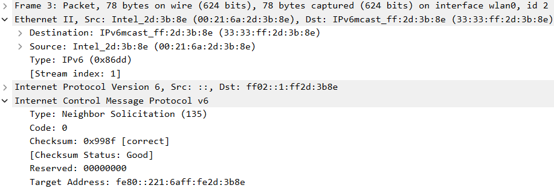

- The source IPv6 address is _::_.

- The _Target Address_ is _fe80::221:6aff:fe2d:3b8e_, meaning Device A is trying to find another device with that _Link-local_ address. This signals that Device A already assigned to itself _fe80::221:6aff:fe2d:3b8e_.

- No answer was found.

### Unsolicited Router Neighbor Advertisement

- **Packet # 4**: A device (_d4:21:22:76:5b:78_, Router A) proactively sends a _Neighbor Advertisement_ stating it is a router and that all available nodes should update their cache with this MAC address (flags _R and O = 1_).

	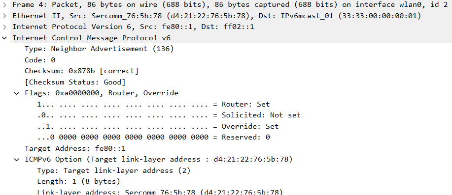

### Client Router Solicitation

- **Packets # 6, 7**:  Device A sends two _Router Solicitations_ (to _ff02::2_). 

	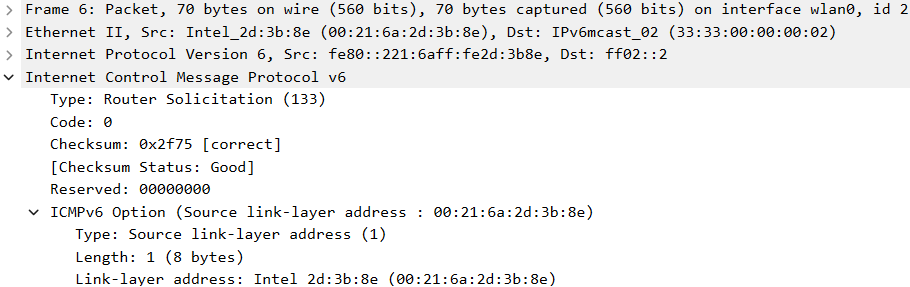

- **Source IPv6**: Device A's Link'Local IP of _fe80::221:6aff:fe2d:3b8e_.

- Inside the ICMPv6 options of one of the _Router Solicitation_ packets, there is a _Link-Layer Address_ pointing at Device A's MAC address: _00:21:6a:2d:3b:8e_.

### Router Neighbor Solicitation and Client Response

- **Packet # 8**: After Device A's _Router Solicitation_, Router A (using the source address _fe80::1_) sends a _Neighbor Solicitation_, specifically asking **who** the IPv6 _fe80::221:6aff:fe2d:3b8e_ address (Device A).

	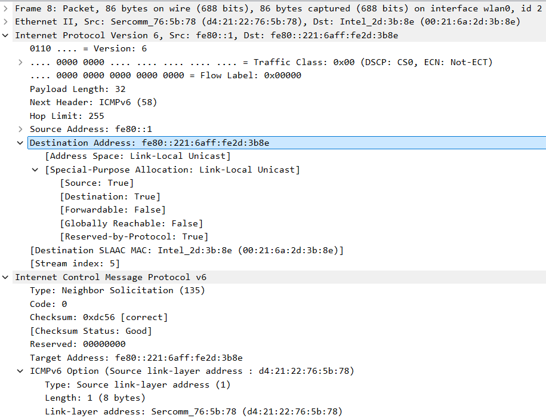

- **Packet # 9**: Device A responds back to the solicitation (the _SOL_ flag), stating **it** has that Link-Local address to Router A. 

	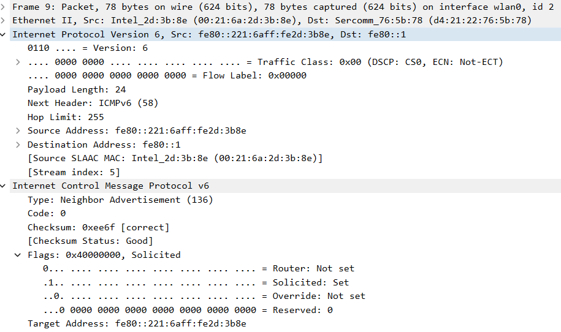

- Keep an eye on the _Stream Index_ (Wireshark field) field, which in this case, for both solicitation and advertisement, is 5. The _Stream Index_ for the previous packets were different.
### Router Advertisement

- **Packet # 10**: Router A sends the Prefix (_2003:50:aa10:4243::/64_), MTU (1492), and a flag stating it _should_ be the default router (with some timers).

	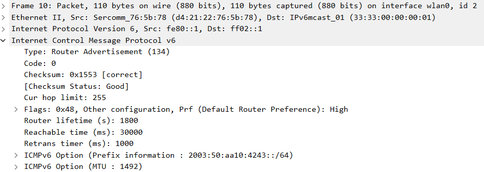

- For curioity reasons, here are some definitions of those timers:
	- **Router Lifetime**: the time Router A is a valid _default gateway_.
	- **Reachable Time**: how long a neighbor should be considered as _reachable_.
	- **Retrans Time**: the time allowed between _Neighbor Solicitations_ from Device A.

### Last Neighbor Solicitation

- **Packet # 16**: Finally, a _Neighbor Solicitation_ for _2003:50:aa10:4243:221:6aff:fe2d:3b8e_, which is exactly the _Router Advertisement's_ prefix and Device A's EUI-64.

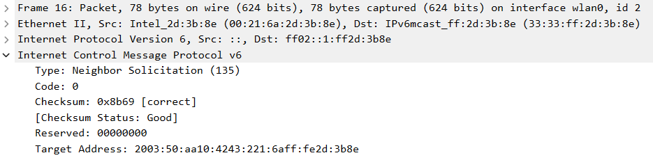

## Conclusions

- Following a SLAAC conversation is not easy, since Wireshark does not provide additional help to link both solicitations and advertisements. A EUI-64 filter might come in handy in Wireshark ease the search time.

- The IPv6 multicast addresses make it a challenge sometimes to know which advertisements correspond with which solicitations. This means a SLAAC process must be followed from the first solicitation.

--------------------------------------------------------------------------

# IPv6 Findings

Keeping on with some CCNA findings, I thought of looking for the different kinds of IPv6 addresses. I will turn again toward  [Johannes Weber's Ultimate PCAP](https://weberblog.net/the-ultimate-pcap/) for this purpose.

_Remember_, an IPv6 address is 128 bits long.

## Introduction

- _File_: IPV6_Captures_UltimatePCAP.pcapng
- _Context_: Studying for the CCNA's IPv6 module

## Findings

### General IPv6

- _Filter_: `ipv6`
- _Packets_: 21118 (100%)
- _Protocols_:
	- The normal ones like TCP, UDP, DNS, Echo, RDP, among others.
	- Some rare ones like Discard Protocol, Daytime Protocol, Character Generator Protocol, among others.

### Global Unicast IPv6

- _Filter_: `ipv6.addr eq 2000::/3`
- _Packets_: 17238 (81.6%)
- _Description_: These are internally and externally routable IPv6 addresses.

	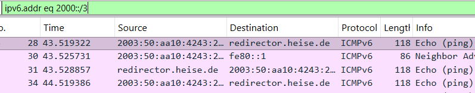

### Multicast IPv6

- _Filter_: `ipv6.addr eq ff::/8`
- _Packets_: 39 (0.2%)
- _Description_:
	- The following list of "endpoints" reflect the **Solicited Node Multicast**, as seen with the prefixed `ff02::1:ff` addresses.
		- Judging by some of the source MAC addresses, the Solicited Node Multicast has the same last 6 hexadecimal as those seen in the MAC address. 

		
		- The majority of these are Neighbor Solicitations, which are the IPv6 version of ARP packets. The source is executing a **Duplicate Address Detection (DAD)** to see if another device that has the same **Link-Local Address** in the `fe80::/10` range, ending in the same last 6 hex values. I think another dedicated IPv6 post is due, so I can analyze anything about this protocol.

		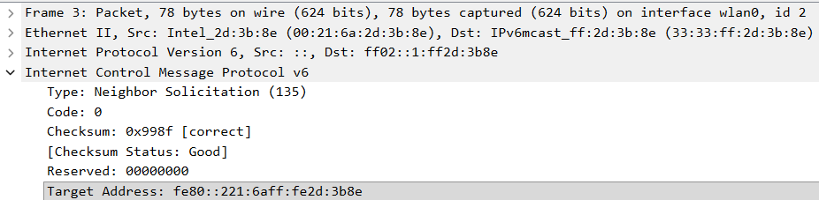

	- The `ff02::16` Multicast address, which is used from endpoints to L3 devices, to let them know if the source wants to be a part of a multicast group, who they want to listen to and who not to listen to. 
	- There are also a bunch of IPv6 muticast packets to nodes and routers, defined by `ff02::1` and `ff02::2`, respectively.

		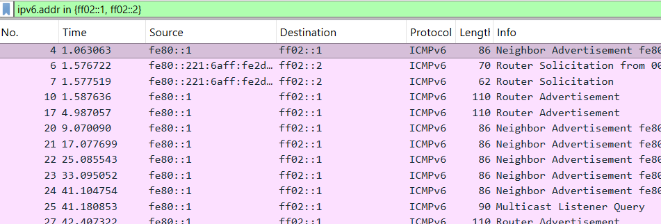

### Link-Local IPv6 Address

- _Filter_: `ipv6.addr eq fe80::/10`
- _Packets_: 3999 (18.9%)
- _Description_:
	- IPv6's APIPA version, in some cases.
	- There are basically two types of _Link-Lokal IPV6 addresses_: the `fe80::1` and the `fe80::<EUI-64>`.
	- Aside from that, they are involved with the following Multicast IPv6's: `ff02::1` (Neighbor / Router Advertisements) , `ff02::16` (Multicast Listener), `ff02::5` (OSPF, including `ff02::6`) and among others. 

### Unique Local IPv6

- _Filter_: `ipv6.addr in {fc00::/7, fd00::/7}`
- _Packets_: 3 (approx. 0.0%)
- _Description_:
	- These addresses are only routable within the same network; not routable to the internet. This is the IPv6 version of "private addresses".
	- Only NTP traffic in this case.

		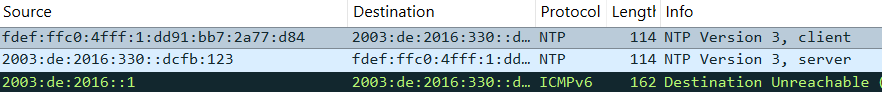

### IPv6 Loopback Address

- _Filter_: `ipv6.addr eq ::1`
- _Packets_: 0 (0%)

### IPv6 Unspecified Address

- _Filter_: `ipv6.addr eq ::`
- _Packets_: 39 (0.2%)
- _Description_:
	- ICMPv6 packets exclusively.
	- Multicast Listener Report Messages and Neighbor Solicitations, are among the messages sent.

		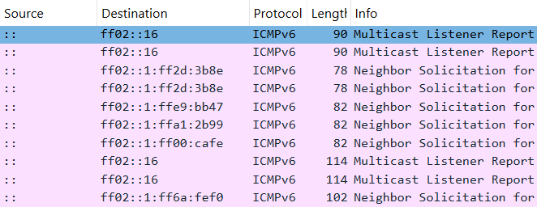

## Conclusions

- IPv6 is used in today's networks.

- The Global Unicast and Link-Local addresses are the most numerous. This is expected, given each one's use cases, where the former is for internal and external communication, while the applied as APIPA or as a self-generated IP.

--------------------------------------------------------------------------

# CDP and LLDP Findings

I am currently re-studying the Cisco CCNA, and when learning about CDP and LLDP, a lightbulb lit up in my head... what would these two look in Wireshark? 

Since I had no way to simulate CDP and LLDP on the fly, I turned to [Johannes Weber's Ultimate PCAP](https://weberblog.net/the-ultimate-pcap/), and fortunately I found these traffic types, which I will analyze right now.

## Introduction

- _File_: The_Ultimate_PCAP.pcapng
- _Context_: Studying for the CCNA's CDP and LLDP.

## Cisco Discovery Protocol

- According to theory, CDP-talking devices advertise their information to other CDP-talking devices. This means CDP traffic provides information to the adjacent device.

- First thing I noticed, was the different stack in the packet:
	- **_Frame_**: The usual Frame information.
	- **_IEEE 802.3 Ethernet_**: Where the multicast destination MAC is found (_01:00:0c:cc:cc:cc_).
	- **_Logical-Link Control_**: Where, according to some investigation, is where Cisco managed to create its custom organization code (00:00:0c), and the CDP code (_0x2000_).
	- **_Cisco Discovery Protocol_**: Where the good stuff happens.

	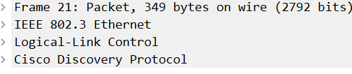

- In the CDP layer, I found several pieces of valuable information from the host advertising CDP. The following are things to note:
	- **Device ID_***: the device's name.
	- **_Software Version_**: the device's OS version.
	- **_Port ID_**: the device's interface, that sent the CDP. In this case, a FastEthernet0/1.
	- **_Platform_**: The device's product line (Cisco 3725)
	- **_Addresses_**: CDP also advertises IP addresses.
	- **_Capabilities_**: Can it be a router? A switch? A Host? Some of them? All of them?
	- **_Duplex_**: whether the device supports full / half duplex.

	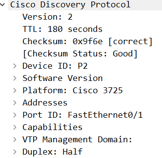

## Link-Layer Discovery Protocol

- The packet stack is different here, maybe because LLDP is a newer protocol than CDP:
	- **_Frame_**: The usual frame information.
	- **_Ethernet II_**: An Ethernet standard, a bit different from the IEEE 802.3. Here is where the multicast MAC address _01:80:c2:00:00:0e_ resides.
	- ***Link-Layer Discovery Protocol***: Where the good stuff happens.

- Some interesting I found in the LLDP-advertised information (the rest is similar from what was seen in the CDP use case):

	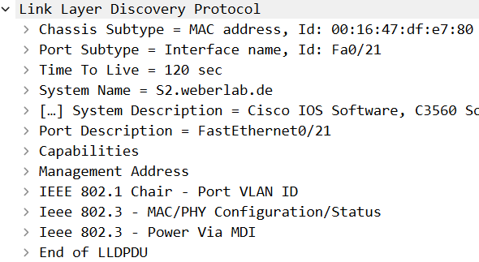
	
	- **_Management Address_**: LLDP is able to send both the IPv4 and IPv6 addresses, if available.

		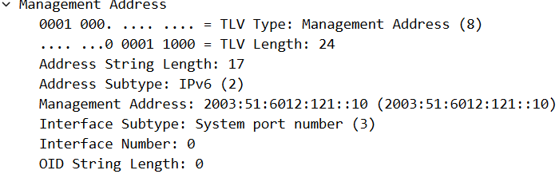
		
	- **IEEE 802.3 - MAC/PHY Configuration/Status:** It has the different physical medium names with their supported duplex modes. If more than 1 is selected, it means the interface will be capable of supporting _auto-negotiation_.

		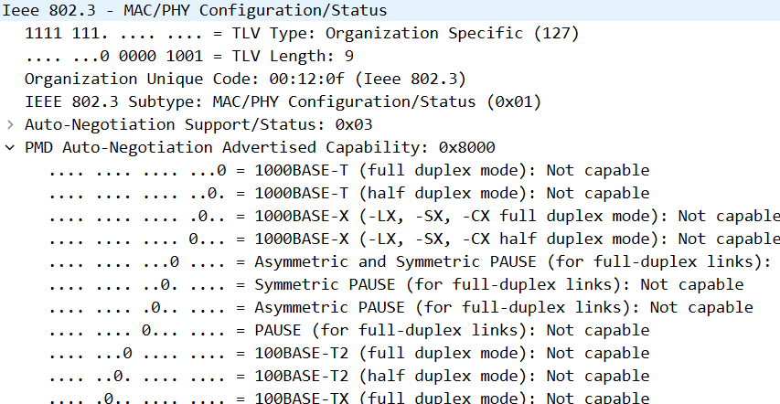

	- **_IEEE 802.3 - Power Via MDI:_** This presents the supported PoE parameters.

		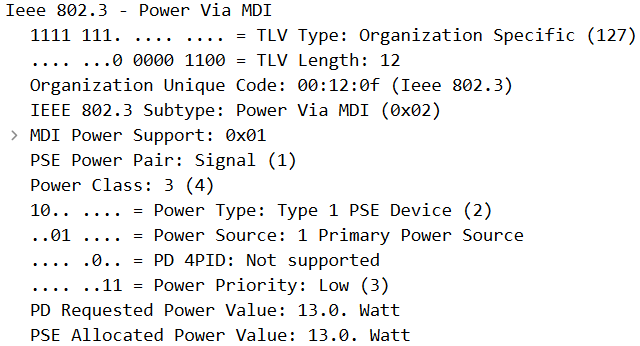

	- **_End of LLDPDU_**: The end of the LLDP packet.

## Conclusions

- Both CDP and LLDP advertise a devices information. The information might be different.

- CDP and LLDP, in general, use different lower-level stacks for the physical medium.

- These traffic types don't require an acknowledgement or response. They just advertise.
